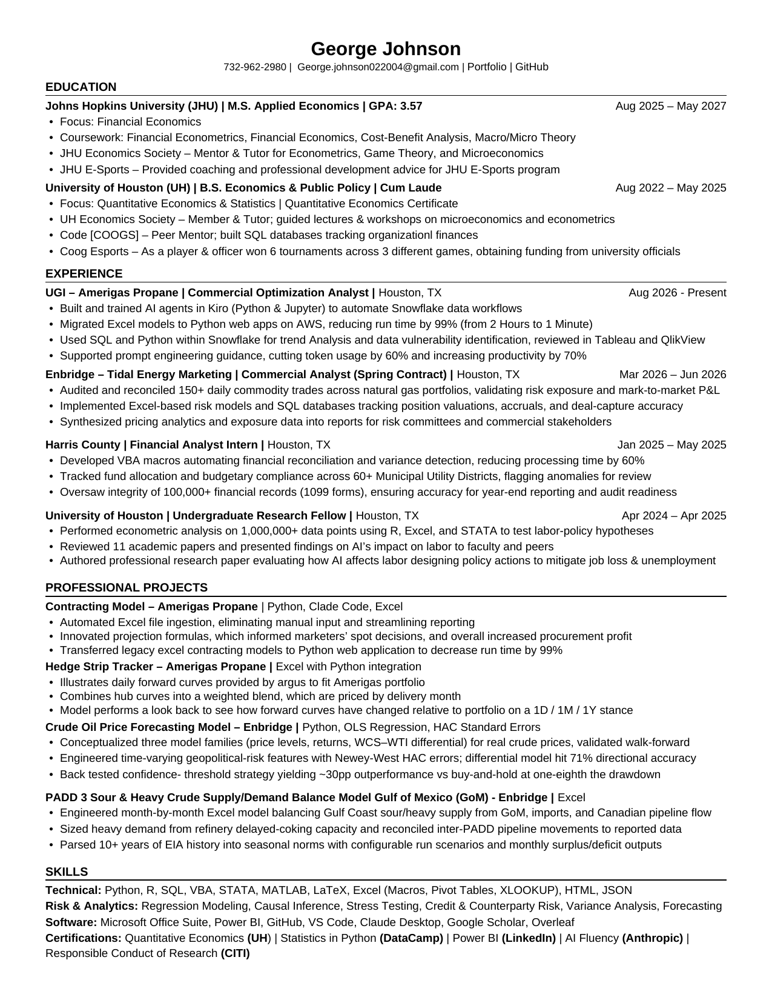

<div align="center">

# George Johnson

**Commercial Optimization Analyst @ UGI AmeriGas · M.S. Applied Economics @ Johns Hopkins**

Energy & Commodities · Risk Modeling · Econometrics · Python & SQL Automation

<a href="https://georgejohnson04.github.io/index.html"></a>
<a href="mailto:george.johnson022004@gmail.com"></a>
<a href="./Johnson_George_Resume.pdf"></a>


</div>

---

## About

I'm a Commercial Optimization Analyst at UGI AmeriGas in Houston. Most of my work is rebuilding slow, manual processes in Python and SQL. One Excel contracting model that took two hours to run now runs in about a minute as a web app on AWS, and I build AI agents that automate our Snowflake data workflows.

Before AmeriGas, I worked on the natural gas trading side at Enbridge's Tidal Energy Marketing, reconciling daily trades, tracking P&L, and building crude market models. I'm finishing my M.S. in Applied Economics at Johns Hopkins (May 2027), focused on financial economics.

---

## At a Glance

```text
Role           Commercial Optimization Analyst — UGI AmeriGas
Previously     Commercial Analyst — Enbridge (Tidal Energy Marketing)
Graduate       M.S. Applied Economics — Johns Hopkins University | GPA: 3.57 | May 2027
Undergraduate  B.S. Economics & Public Policy — University of Houston | Cum Laude
Focus          Energy Markets · Risk Modeling · Econometrics · Data Automation
Location       Houston, TX
```

---

## Resume

<div align="center">

<a href="./Johnson_George_Resume.pdf">
  
</a>

<br/>

<a href="./Johnson_George_Resume.pdf"></a>
<a href="https://raw.githubusercontent.com/GeorgeJohnson04/GeorgeJohnson04/main/Johnson_George_Resume.pdf"></a>

</div>

---

## Tech Stack

**Languages & Statistical Tools**


**Data & Cloud**


**Analytics & BI**

-217346?style=flat-square&logo=microsoft-excel&logoColor=white)


**Python Libraries**


**AI & Dev Tools**


---

## Experience

**UGI — AmeriGas Propane**  |  *Commercial Optimization Analyst*  |  Houston, TX  |  Aug 2026 – Present
- Built and trained AI agents in Kiro (Python & Jupyter) to automate Snowflake data workflows
- Migrated Excel models to Python web apps on AWS, cutting run time by **99%** (from 2 hours to 1 minute)
- Used SQL and Python in Snowflake for trend analysis and data vulnerability checks, reviewed in Tableau and QlikView
- Led prompt engineering guidance that cut token usage by **60%** and raised productivity by **70%**

**Enbridge — Tidal Energy Marketing**  |  *Commercial Analyst (Spring Contract)*  |  Houston, TX  |  Mar 2026 – Jun 2026
- Audited and reconciled **150+** daily commodity trades across natural gas portfolios, validating risk exposure and mark-to-market P&L
- Built Excel-based risk models and SQL databases tracking position valuations, accruals, and deal-capture accuracy
- Synthesized pricing analytics and exposure data into reports for risk committees and commercial stakeholders

**Harris County — Treasury Department**  |  *Financial Analyst Intern*  |  Houston, TX  |  Jan 2025 – May 2025
- Developed VBA macros automating financial reconciliation and variance detection, reducing processing time by **60%**
- Tracked fund allocation and budgetary compliance across **60+** Municipal Utility Districts, flagging anomalies for review
- Oversaw integrity of **100,000+** financial records (1099 forms) for year-end reporting and audit readiness

**University of Houston**  |  *Undergraduate Research Fellow*  |  Houston, TX  |  Apr 2024 – Apr 2025
- Performed econometric analysis on **1,000,000+** data points using R, Excel, and STATA to test labor-policy hypotheses
- Reviewed 11 academic papers and presented findings on AI's impact on labor to faculty and peers
- Authored a research paper on how AI affects labor, with policy recommendations to reduce job loss and unemployment

**Asia Society**  |  *Financial Analyst Intern*  |  May 2024 – Aug 2024
- Structured cost-benefit models supporting program initiatives that drove **43%** revenue growth across the cycle
- Cleaned survey data and refined methodology, lifting survey effectiveness **22%** and surfacing untapped demographics

---

## Professional Projects

### UGI AmeriGas

**Contracting Model**  |  `Python` `Claude Code` `Excel` `AWS`
> Rebuilt legacy Excel contracting models as a Python web app, cutting run time by **99%**. Automated Excel file ingestion to remove manual input, and built projection formulas that inform marketers' spot purchasing decisions.

**Hedge Strip Tracker**  |  `Excel` `Python`
> Maps daily Argus forward curves onto the AmeriGas portfolio, blending hub curves into a weighted price by delivery month. Includes a 1D / 1M / 1Y look-back showing how curves have moved relative to the portfolio.

**Snowflake Landed-Cost Reporting**  |  `Python` `Snowflake` `SQL` `Excel`
> Scripts that pull per-load landed costs from Snowflake and check them for outliers, blanks, duplicates, spelling variants, and date gaps. Archives history through Time Travel and compares district costs to the finance workbook in formatted Excel reports.

### Enbridge

**Crude Oil Price Forecasting Model**  |  `Python` `OLS Regression` `HAC Standard Errors`
> Built three model families (price levels, returns, and the WCS–WTI differential) for inflation-adjusted crude prices, validated walk-forward. With time-varying geopolitical-risk features and Newey-West HAC errors, the differential model reached **71% directional accuracy**, and a confidence-threshold strategy backtested to ~**30pp** outperformance vs. buy-and-hold at one-eighth the drawdown. [](https://github.com/GeorgeJohnson04/OLS-Crude-Oil-Model-Enbridge)

**PADD 3 Sour & Heavy Crude Supply/Demand Balance Model**  |  `Excel`
> Month-by-month Excel model balancing Gulf Coast sour/heavy supply from Gulf of Mexico production, waterborne imports, and Canadian pipeline flows. Sizes heavy demand from refinery coking capacity, reconciles inter-PADD movements to reported data, and turns **10+ years** of EIA history into seasonal norms with configurable scenarios. [](https://github.com/GeorgeJohnson04/PADD-3-Supply-Demand-Balance-Model)

**Texas RRC Pipeline Volume Scraper**  |  `Python` `Playwright` `pdfplumber` `openpyxl`
> Pulls Texas Railroad Commission T-1 filings for crude pipelines, parses barrel volumes by district from the PDFs, and builds monthly receipts, deliveries, and ending-balance sheets. Merges results into the team's existing workbook without overwriting populated cells or formulas.

**Trade Booking & Invoice Automation**  |  `Excel` `VBA`
> A set of macro-driven workbooks: a deal entry form that books crude deals across every month of a strip with index-linked pricing, a distribution macro that fans financial trades out to monthly tabs, and a pipeline invoice model that converts batch volumes from m³ to barrels and applies US and Canadian tariffs.

---

## Personal Projects

**Cairn — Personal Finance Tracker**  |  `Python` `Flask` `SQLite` `JavaScript`
> Multi-user web app for tracking holdings, trades, dividends, savings goals, and a financial plan, with live prices from Yahoo Finance and CoinGecko. Secured with Argon2id hashing, CSRF protection, rate limiting, and per-user data isolation, and installable on phones as a PWA. Grew out of my original Excel and Python portfolio tracker. [](https://github.com/GeorgeJohnson04/CairnFinance-App) [](https://github.com/GeorgeJohnson04/stock-portfolio-tracker)

---

## Academic Projects

<details>
<summary><b>Click to expand</b></summary>

<br/>

**Economic Policy Impact Simulation**  |  `MATLAB` `Python` `LaTeX`
> Elasticity-based model of how tax and tariff changes affect GDP, GDP per capita, and top 10% wealth concentration. Rebuilt in Python with probability estimates of rising inequality and comparisons of real policy proposals, with a final policy memo. [](https://github.com/GeorgeJohnson04/MATLAB-Donald-Trump-Simulation-Final) [](https://github.com/GeorgeJohnson04/Python-Policy-Analysis-Final)

**Employment & Crime Causal Analysis**  |  `R` `Fixed-Effects Regression`
> Replicated a published AEA study, estimating the effect of employment on crime and detention length across 8 fixed-effects specifications over **100,000+** data points, with state-clustered standard errors. [](https://github.com/GeorgeJohnson04/R-Project-Replication-and-Reanalysis)

**GDP & Child Mortality Analysis**  |  `STATA` `OLS Regression`
> Cross-country analysis of GDP per capita and under-five mortality in 1950 and 2018. Three nested models adding schooling, life expectancy, and urbanization raise R² from 0.10 to 0.39.

**Financial Econometrics**  |  `R` `Time Series`
> Coursework code for JHU Financial Econometrics, starting with stationarity testing (ADF) on daily log returns for financial sector ETFs (XLF, KRE). [](https://github.com/GeorgeJohnson04/Financial-Econometrics-)

**Excel & VBA Coursework**  |  `Excel` `VBA` `Pivot Tables`
> Advanced formulas, pivot tables, and VBA macros from economics coursework, including analysis of EIA petroleum import data. [](https://github.com/GeorgeJohnson04/EXCEL-Proficiency)

</details>

---

## Education

**Johns Hopkins University**  |  M.S. Applied Economics  |  GPA: 3.57  |  Aug 2025 – May 2027
- Focus: Financial Economics
- Coursework: Financial Econometrics, Financial Economics, Cost-Benefit Analysis, Macro/Micro Theory
- JHU Economics Society: mentor and tutor for Econometrics, Game Theory, and Microeconomics
- JHU E-Sports: coaching and professional development for the program

**University of Houston**  |  B.S. Economics & Public Policy  |  Cum Laude  |  Aug 2022 – May 2025
- Focus: Quantitative Economics & Statistics, Quantitative Economics Certificate
- UH Economics Society: tutor leading lectures and workshops on microeconomics and econometrics
- Code [COOGS]: peer mentor, built SQL databases tracking organizational finances
- Coog Esports: player and officer, won 6 tournaments across 3 games and secured university funding

---

## Certifications
- **Quantitative Economics Certificate** — University of Houston
- **Statistics in Python** — DataCamp
- **Power BI** — LinkedIn Learning
- **AI Fluency** — Anthropic
- **Responsible Conduct of Research** — CITI Program
